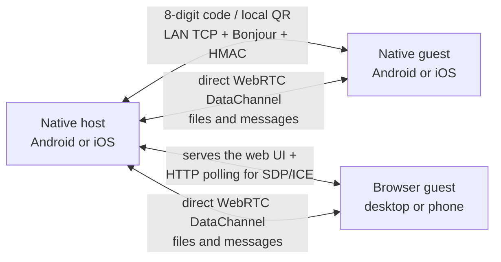

<div align="center">


<!-- The hero image is served from the production site on purpose: the GitHub
     README is the project's storefront. Point it at a committed asset instead
     if you prefer the README to be fully self-contained. -->

# LanShare

**Free file transfer between any devices, over your local network.**

[**Android on Google Play**](https://play.google.com/store/apps/details?id=com.lanshare) · [**GitHub**](https://github.com/open-coolqoo/lan-share) · [FAQ](https://lan-share.com/faq)

[](LICENSE)

</div>

---

LanShare moves files directly between your devices with **no server and no
internet**: one device creates a room locally, the other pairs with an 8-digit
code or a QR scan, and files travel over a direct WebRTC DataChannel on your
Wi-Fi or hotspot. Nothing is uploaded to a cloud.

No account. No cables. No upload-and-wait. It works between phone and computer,
phone and phone, and computer and computer.

## Local pairing

- **Native apps (Android and iOS)** create the room on the device itself: an
  ephemeral TCP listener, Bonjour discovery, and an HMAC-authenticated handshake.
- The host shows a short-lived 8-digit code and a QR. The QR is a local URL
  (`http://<lan-ip>:<port>/?pair=<code>&addr=<ip>:<lan-port>`) that works for
  both paths:
  - the in-app scanner on another phone reads the code and host addresses and
    joins over the LAN socket;
  - a phone camera or a desktop browser opens the native host's local page.
- **Web** runs a tiny local service on the computer (`web/local-service`). The
  service owns the LAN TCP listener and Bonjour advertisement, serves the web
  client, and lets the browser be the room host or a guest; another browser on
  the same Wi-Fi opens the host's URL and pairs with it. A native host can also
  serve the web client through its own bridge. No hosted cloud web deployment is
  used for pairing.

## Download

| Platform | Get LanShare |
| --- | --- |
| Android | **[Google Play](https://play.google.com/store/apps/details?id=com.lanshare)** |
| iOS | App Store — search for “Lan-Share” |
| Web | Run `web/local-service` on a computer, or open the browser address shown by a running Android/iOS host |
| Clients | Build the Web, Android, iOS, and web local service from this repository |

## Why LanShare

- **Direct, serverless transfer.** The host device coordinates the room itself;
  file bytes move device-to-device over a WebRTC DataChannel.
- **Pair in seconds.** An 8-digit code or a QR scan. No accounts, no email, no setup.
- **Cross-platform.** Native Android (Kotlin + Jetpack Compose), native iOS
  (SwiftUI), and the web client served by either native host.
- **Chat while you transfer.** Paired devices can exchange text messages alongside files.
- **Receiver stays in control.** Every incoming item is accepted and saved explicitly.
- **Private by design.** Works on your Wi-Fi or hotspot; no external STUN/TURN
  servers are used. Guest networks with AP isolation and VPNs that block local
  traffic are the common blockers.
- **14 languages.** The app UI ships authored copy in 14 locales.
- **Open source.** Apache-2.0. Audit the clients, build them yourself, or fork them.

## How it works



1. The host creates an 8-digit code, a LAN TCP listener, a Bonjour advertisement,
   and a local HTTP bridge that serves the web client.
2. A native guest joins with the code or the QR: a challenge/HMAC handshake runs
   over the TCP socket, then SDP/ICE flow through the same socket.
3. A browser guest opens the host's local URL. The page calls the host's HTTP
   bridge (`/__bridge__/join`, `/events`, `/signal`); the host emits the WebRTC
   offer and the browser answers.
4. Files and chat messages travel over the DataChannel. The bridge only carries
   signaling, never file bytes.

## Source layout

```text
web/public-ui/         Web client (React + TypeScript + Vite)
web/local-service/     Web local service (Node.js; LAN listener, Bonjour, signaling bridge)
android/               Android client (Kotlin + Compose)
ios/                   iOS client (SwiftUI; project.yml is the XcodeGen source of truth)
```

## Prerequisites

- Node.js 24 and npm
- Android Studio/JDK for the Android build
- Xcode 26+ for the iOS build

## Web client

Build the web client first; both the local service and the native apps serve
that build.

```bash
cd web/public-ui
npm install
npm run build
```

Then run the web local service on the computer that should host the room:

```bash
cd web/local-service
npm install
npm start
```

The service prints a **host page** URL (with a one-time host token) and a
**guest URL**/QR for other devices. It opens the host page automatically by
default; pass `--no-open` to skip that, or `--port 8080` to pin the HTTP port.

- The host page must stay open while another device is paired.
- A native Android/iOS guest can scan the QR and join over the LAN TCP socket.
- A browser guest (including another computer on the same Wi-Fi) can open the
  guest URL or the host's browser address.
- `web/local-service` is a Node.js process: the web client itself cannot listen
  on a LAN port, so this local service is what makes the browser a local host.

`npm run dev` in `web/public-ui` starts the Vite UI for development, but without
a local service or a native host the page cannot pair. The production build
output (`web/public-ui/dist`) is generated and gitignored; build it before the
native apps or the local service.

## Android

Build the debug APK:

```bash
cd android
./gradlew :app:assembleDebug
```

The Gradle build copies `web/public-ui/dist` into the APK as `assets/web` and
fails with a clear message if the web client has not been built.

Version defaults live in `android/version.properties`; override them with
`-PappVersionCode` and `-PappVersionName` when invoking Gradle.

Android 17 (API 37) requires the `ACCESS_LOCAL_NETWORK` runtime permission for
the LAN listener, WebRTC host candidates, and the browser bridge. The app
requests it on launch and shows a settings card when it is denied.

Release signing reads `android/release-signing.properties`. `android/scripts/create-release-key.sh` creates the upload key, and `android/scripts/build-release-aab.sh` builds the signed bundle.

## iOS

The generated `LanShare.xcodeproj` is committed, so a clone builds without XcodeGen. `ios/project.yml` is the source of truth; regenerate with `xcodegen` after changing it.

The project intentionally has no signing team configured. Open it in Xcode, select your own team under Signing & Capabilities (or set `DEVELOPMENT_TEAM` in `ios/project.yml` and run `xcodegen`), then run:

```bash
cd ios
open LanShare.xcodeproj
```

A post-build script copies `web/public-ui/dist` into `.app/web`; build the web
client first. The iOS local-network permission is required for the LAN listener
and browser bridge; the app shows a banner and a Settings shortcut when it is
denied.

The WebRTC dependency (`stasel/WebRTC`, version-pinned) resolves through Swift Package Manager on first build.

Build the `LanShare` scheme in Xcode.

## Limits

- The host must stay in the foreground while another device is paired: iOS
  suspends background apps and stops the HTTP bridge; the local service must
  keep running on the computer.
- The web local service is a Node.js process. The browser alone cannot listen on
  a LAN port, so a web-hosted room requires that service (or a native host).
- If a direct connection fails, verify both devices are on the same Wi-Fi/LAN or
  hotspot, disable VPN/proxy, and check guest-network/AP isolation and firewall
  rules.

## Verification

```bash
cd web/public-ui
npm test
npm run build
```

The local service needs the built web client; a quick check is:

```bash
cd web/local-service
npm install
node src/cli.mjs --no-open
# in another shell, use the printed host page URL:
# curl http://127.0.0.1:<port>/__bridge__/info
```

Android: `cd android && ./gradlew :app:assembleDebug`; confirm the APK contains
`assets/web/index.html`. iOS: build the `LanShare` scheme in Xcode; confirm the
app bundle contains `web/index.html`.

## Contributing

Bug reports, feature ideas, and pull requests are welcome. For code changes, run the tests for the client you changed and keep commits conventional (`feat:`, `fix:`, `docs:`, …).

## License

Licensed under the [Apache License, Version 2.0](LICENSE).

Apache-2.0 is a permissive license with an explicit patent grant: you may use, modify, and redistribute LanShare — commercially — as long as the license and copyright notices are preserved. It deliberately does **not** grant any trademark rights: the LanShare name, the logo, and the [lan-share.com](https://lan-share.com) domain are not part of the license grant, so if you fork or redistribute, please give your build its own name rather than presenting it as LanShare.
