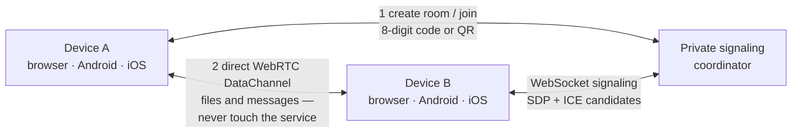

<div align="center">


<!-- The hero image is served from the production site on purpose: the GitHub
     README is the project's storefront. Point it at a committed asset instead
     if you prefer the README to be fully self-contained. -->

# LanShare

**Free file transfer between any devices, over your local network.**

[**lan-share.com**](https://lan-share.com) · [**Android on Google Play**](https://play.google.com/store/apps/details?id=com.lanshare) · [FAQ](https://lan-share.com/faq)

[](LICENSE)

</div>

---

LanShare moves files directly between your devices: create a room on one device, pair another device with the 8-digit room code or a QR scan, and send files over a direct WebRTC connection on your Wi-Fi or hotspot. The coordinating server never sees file contents, and nothing is stored in any cloud.

No account. No cables. No upload-and-wait. It works between phone and computer, phone and phone, and computer and computer — across operating systems, because the web client runs in any browser.

## Download

| Platform | Get LanShare |
| --- | --- |
| Web — any device, nothing to install | **[lan-share.com](https://lan-share.com)** |
| Android | **[Google Play](https://play.google.com/store/apps/details?id=com.lanshare)** |
| iOS | App Store — search for “Lan-Share” |
| Clients | Build the Web, Android, and iOS clients from this repository |

## Why LanShare

- **Direct transfer, no cloud.** Files move device-to-device over a WebRTC DataChannel on the local network. The private signaling service coordinates the handshake only — file bytes never leave your devices.
- **Pair in seconds.** An 8-digit code or a QR scan. No accounts, no email, no setup.
- **Cross-platform.** Web in any browser, native Android (Kotlin + Jetpack Compose), native iOS (SwiftUI). All three clients interoperate over one protocol.
- **Chat while you transfer.** Paired devices can exchange text messages alongside files.
- **Receiver stays in control.** Every incoming item is accepted and saved explicitly by the receiving side.
- **Private by design.** Works on your Wi-Fi or hotspot; guest networks with AP isolation and VPNs that block local traffic are the only common blockers.
- **14 languages.** The app UI ships authored copy in 14 locales.
- **Open source.** Apache-2.0. Audit the clients, build them yourself, or fork them.

## How it works



1. One device creates a room and receives a short-lived 8-digit code plus a QR code.
2. The other device joins with the code. Both sides open a WebSocket signaling channel to the private signaling service and exchange WebRTC offers, answers, and ICE candidates.
3. The devices establish a direct peer-to-peer connection and files (and chat messages) flow over the WebRTC DataChannel.

The private signaling service handles room lifecycle, WebSocket signaling, and heartbeats. It never relays file data. LanShare uses direct local-network WebRTC with no external ICE servers, so both devices need to be on the same Wi-Fi/LAN or hotspot.

## Source layout

```text
web/public-ui/         Web client (React + TypeScript + Vite)
android/               Android client (Kotlin + Compose)
ios/                   iOS client (SwiftUI; project.yml is the XcodeGen source of truth)
```

## Prerequisites

- Node.js 24 and npm
- Android Studio/JDK for the Android build
- Xcode 26+ for the iOS build

## Web client

```bash
cd web/public-ui
npm install
npm run dev
```

Create a production build with `npm run build`.

The public client uses placeholder room/signaling paths under `/__private__`. A private build sets `VITE_PRIVATE_API_BASE` (room API prefix) and `VITE_SIGNALING_URL` (WebSocket URL); the dev server proxies `/__private__` to `VITE_API_TARGET`.

## Android

Build the debug APK:

```bash
cd android
./gradlew :app:assembleDebug
```

Version defaults live in `android/version.properties`; override them with `-PappVersionCode` and `-PappVersionName` when invoking Gradle.

The public client ships placeholder room/signaling paths. A private build passes `-PprivateRoomApiPrefix=...` and `-PprivateSignalingPath=...`; `DEFAULT_SERVER_ORIGIN` sets the backend origin.

Release signing reads `android/release-signing.properties`. `android/scripts/create-release-key.sh` creates the upload key, and `android/scripts/build-release-aab.sh` builds the signed bundle.

## iOS

The generated `LanShare.xcodeproj` is committed, so a clone builds without XcodeGen. `ios/project.yml` is the source of truth; regenerate with `xcodegen` after changing it.

The project intentionally has no signing team configured. Open it in Xcode, select your own team under Signing & Capabilities (or set `DEVELOPMENT_TEAM` in `ios/project.yml` and run `xcodegen`), then run:

```bash
cd ios
open LanShare.xcodeproj
```

The public client uses placeholder endpoints in `ios/LanShare/Room/RoomApiClient.swift` (`PrivateEndpoints`). A private build replaces those constants; `defaultOrigin` sets the backend origin (debug builds also honor `LANSHARE_ORIGIN`).

The WebRTC dependency (`stasel/WebRTC`, version-pinned) resolves through Swift Package Manager on first build.

Build the `LanShare` scheme in Xcode.

## Private backend endpoints

The room/signaling service is not part of this repository. The public clients ship placeholders and need a private build configuration:

| Client | Configuration |
| --- | --- |
| Web | `VITE_PRIVATE_API_BASE`, `VITE_SIGNALING_URL` |
| Android | `-PprivateRoomApiPrefix`, `-PprivateSignalingPath`, `DEFAULT_SERVER_ORIGIN` |
| iOS | `PrivateEndpoints` in `RoomApiClient.swift`, `defaultOrigin` / `LANSHARE_ORIGIN` |

If a direct connection fails, verify both devices are on the same Wi-Fi/LAN or hotspot, disable VPN/proxy, and check guest-network/AP isolation and firewall rules.

## Verification

```bash
cd web/public-ui
npm test
npm run build
```

Android: `cd android && ./gradlew :app:assembleDebug`. iOS: build the `LanShare` scheme in Xcode.

## Contributing

Bug reports, feature ideas, and pull requests are welcome. For code changes, run the tests for the client you changed and keep commits conventional (`feat:`, `fix:`, `docs:`, …).

## License

Licensed under the [Apache License, Version 2.0](LICENSE).

Apache-2.0 is a permissive license with an explicit patent grant: you may use, modify, and redistribute LanShare — commercially — as long as the license and copyright notices are preserved. It deliberately does **not** grant any trademark rights: the LanShare name, the logo, and the [lan-share.com](https://lan-share.com) domain are not part of the license grant, so if you fork or redistribute, please give your build its own name rather than presenting it as LanShare.
